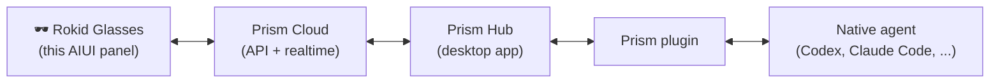

# Prism Panel — Rokid Glasses AIUI

**English** / [中文](#中文)

The official [Prism](https://github.com/prism-rokid) client for Rokid AI
glasses. Keep your AI coding agents running where they work best — on your
desktop — and stay in control from your glasses: follow conversations, dictate
messages, answer approval requests, and watch usage quotas, hands-free.

Prism connects to agents such as Codex, Claude Code, Hermes, OpenClaw and
CodeBuddy through plugins. This panel renders whatever the user has connected,
so new agents appear here automatically — see
[build-your-own integrations](#build-your-own-agent-integration) below.

## What you get

- **Full conversation view** — remote sessions streamed live over NDJSON with
  Markdown rendering, tool calls and step-by-step progress.
- **Voice-first input** — dictate messages through the glasses microphone;
  a single tap stops, a long press re-opens the menu.
- **Stay in control** — switch host/plugin/thread, model, reasoning effort and
  permission mode; interrupt a running task at any time.
- **Approvals on the go** — resolve permission requests directly from the
  glasses before your agent unblocks itself.
- **Two home-screen widgets** — `Prism Usage` (5-hour / weekly quota windows,
  working + unread counters) and `Prism Conversations` (latest, running and
  unread sessions, bottom-aligned like the glasses launcher).
- **Four locales** — 简体中文, 繁體中文, English, 日本語, resolved from the
  device locale.

## How it works



The panel talks only to the Prism cloud API: catalogs refresh with
signature-based light polling (3 s), while conversation detail and bodies
arrive as an NDJSON state stream. Authentication uses a host-issued device
credential (`navigator.requestDeviceToken()`); no token is ever embedded in
the source, written to logs, or persisted to disk.

## Repository map

| Path | Role |
| --- | --- |
| `pages/index/` | The page: a thin composition root over method groups |
| `lib/prism-page-*.js` | Page behavior by concern — boot, sync, stream, menu, voice, input |
| `lib/prism-api.js` | The full remote contract: endpoints, envelope unwrapping, NDJSON state stream |
| `lib/prism-*-model.js` | Pure model builders (chat, inbox, labels, widget summaries) |
| `lib/prism-widget-runtime.js` | Shared widget core: i18n, auth, polling, refresh policy |
| `widgets/prism-usage/`, `widgets/prism-conversations/` | The two 1×1 home-screen widgets |
| `lib/i18n/` | Locale packs; all packs keep an identical key set (test-enforced) |
| `dev/cors-proxy.mjs` | Local CORS relay for browser preview |
| `tests/` | 160+ `node:test` cases — models, source-shape, gestures, widgets |

New contributor starting points: `pages/index/index.js` (the map),
`lib/prism-api.js` (the remote contract), `lib/prism-widget-runtime.js`
(how both widgets share boot/auth/polling).

## Getting started (development)

```bash
git clone https://github.com/prism-rokid/prism-aiui.git
cd prism-aiui
npm install
npm test
npm run pack        # -> ../.aiui-build/prism-aiui/package.aix
```

1. Import the repo into [Craft](https://js.rokid.com) (the AIUI studio) and
   preview `pages/index/index`. The page targets the glasses' 480×352 logical
   viewport — it is sized in fixed `px`, not `rpx` or `100vh`.
2. To sign in, connect the Prism desktop hub to your account first; the panel
   acquires its device credential from the glasses at startup.
3. For browser preview against a Prism gateway, run
   `node dev/cors-proxy.mjs` (NDJSON streams are piped unbuffered).

### Environments

Packaged builds target the **production** gateway
(`https://ai-cloud.rokid.com/prism/api`). For local development against the
test environment, drop a gitignored `env.json` in the repo root:

```json
{ "baseUrl": "https://ai-cloud-test.rokid.com/prism/api" }
```

`env.json` is excluded from both git (`.gitignore`) and the packaged AIX
(`.aixignore`), so the override never leaves your machine.

## Build your own agent integration

Two supported paths, depending on what you want to add:

1. **A new agent for Prism** (most cases): write a plugin with the
   [PluginBridge SDK](https://github.com/prism-rokid/prism-plugin-sdk) — Go,
   TypeScript or Python. The plugin bridges Prism Hub to your agent; this
   panel needs no changes and will list, render and control it automatically.
2. **A different glasses panel**: fork this repo as a template. The pieces
   built to be reused are the device-credential flow
   (`lib/prism-device-auth.js`), the NDJSON stream client
   (`lib/prism-api.js`), the per-surface touchpad gesture layer
   (`lib/prism-gesture.js`, `lib/prism-page-input.js`), the widget runtime
   (`lib/prism-widget-runtime.js`) and the four-locale i18n core. Swap the
   API client for your backend and keep the rest.

## Contributing

Bug reports, fixes, locale packs and widget/layout improvements are all
welcome — see [CONTRIBUTING.md](./CONTRIBUTING.md) for the development loop
and code expectations. Good first areas: i18n coverage, widget layouts,
gesture tuning on new firmware, and test coverage for the model builders.

## License

[MIT](./LICENSE) — vendored markdown libraries keep their own notices under
[`lib/vendor/`](./lib/vendor/).

---

# 中文

Rokid AI 眼镜上的官方 [Prism](https://github.com/prism-rokid) 客户端。让编程
Agent 在桌面端专心干活，你在眼镜上随时掌控：跟进会话、语音输入、处理审批、查看
额度，全程解放双手。

Prism 通过插件接入 Codex、Claude Code、Hermes、OpenClaw、CodeBuddy 等 Agent。
面板只负责呈现用户已连接的插件，新 Agent 接入后自动出现。

## 功能

- **完整会话视图** — NDJSON 状态流实时推送，Markdown 渲染、工具调用与执行
  进度一目了然。
- **语音优先输入** — 眼镜麦克风听写；单击停止，长按呼出菜单。
- **远程控制** — 切换主机/插件/线程、模型、推理强度与权限模式，随时打断任务。
- **移动审批** — 直接在眼镜上解决权限请求，Agent 不再阻塞等待。
- **两个桌面小组件** — 「棱镜用量」（5 小时/每周额度、工作中与未读计数）和
  「棱镜会话」（最新、运行中、未读会话，底对齐布局）。
- **四种语言** — 简体中文、繁體中文、English、日本語，跟随设备语言。

## 工作原理

面板只与 Prism 云端通信：目录用签名轻轮询（3 秒），会话详情与正文走 NDJSON
状态流。鉴权使用宿主签发的设备凭据（`navigator.requestDeviceToken()`），源码、
日志与磁盘中都不会出现 token。

## 开发

```bash
npm install
npm test
npm run pack
```

用 [Craft](https://js.rokid.com) 导入仓库预览 `pages/index/index`（480×352
逻辑视口）；浏览器联调网关运行 `node dev/cors-proxy.mjs`。打包产物默认连正式
环境，本地连测试环境请在根目录放置 gitignore 的 `env.json`
（`{ "baseUrl": "https://ai-cloud-test.rokid.com/prism/api" }`）。

代码结构、环境切换、贡献流程见 [CONTRIBUTING.md](./CONTRIBUTING.md)。

## 接入你自己的 Agent

- **给 Prism 接新 Agent**：用
  [PluginBridge SDK](https://github.com/prism-rokid/prism-plugin-sdk) 写插件
  （Go / TypeScript / Python），面板零改动即可自动展示与控制。
- **做另一副眼镜面板**：以本仓库为模板，复用设备凭据、NDJSON 流客户端、
  触控手势层、小组件运行时与四语言 i18n，替换 API 客户端即可。

## 许可

[MIT](./LICENSE)；内嵌的 markdown 库在 [`lib/vendor/`](./lib/vendor/) 保留各自
的许可声明。
